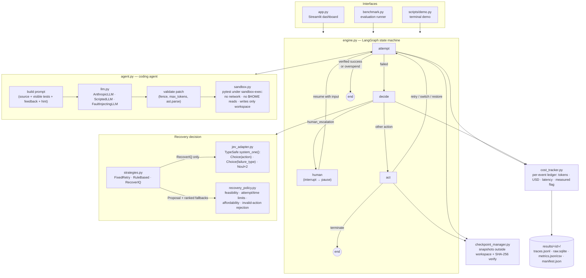

# RecoverIQ architecture

## Data flow for one failure

1. **attempt** — the agent builds a prompt from the target file, the *visible* tests and
   feedback from earlier attempts (hidden acceptance-test details are withheld), calls the
   current model tier, validates the reply (code fence present, not cut off at `max_tokens`,
   parses with `ast`), writes only the target file, and runs the full suite (visible +
   acceptance) inside the sandbox. The outcome is classified as one of `success`,
   `llm_error`, `output_truncated`, `malformed_output`, `collection_error`, `test_failure`,
   `acceptance_failure`, `timeout`. A known-good checkpoint is saved when a patch applied
   cleanly, more tests pass than ever before, **and** every file other than the target still
   matches the initial snapshot, so silently damaged state is never captured as "good".
2. **decide** — a `RecoveryContext` (failure type, error summary, attempts, model, remaining
   budget, previous actions, damaged files, available options, per-option cost estimates)
   goes to the strategy. RecoverIQ sends it as JSON `state` to Jev with four questions in one
   call; the action Choice offers only currently-feasible actions. The strategy returns a
   proposal plus ranked fallbacks.
3. **policy** — `RecoveryPolicy.decide` independently rejects invalid, infeasible, unsafe or
   unaffordable proposals and walks the fallback ranking; if nothing survives it terminates.
   This applies identically to all three strategies.
4. **act / human** — `retry` re-enters attempt on the same tier; `switch_model` moves to the
   next tier (a different model with a larger output budget); `restore_checkpoint` replaces
   the workspace with the best known-good snapshot and verifies hashes; `human_escalation`
   calls LangGraph `interrupt()` and resumes with the reply as guidance; `terminate` ends.

## Isolation boundaries

| Asset | Who can touch it |
|---|---|
| `.env`, `~/.ssh`, anything under `$HOME` | host process only — sandbox denies `file-read-data` |
| Network | host process only — sandbox denies `network*` |
| Workspace (`runs/<run>/workspace`) | agent writes the target file; sandboxed tests may write here |
| Checkpoints (`runs/<run>/checkpoints`) | host only — outside the sandbox's writable area |
| Environment variables | sandbox gets a scrubbed env (no API keys) |
